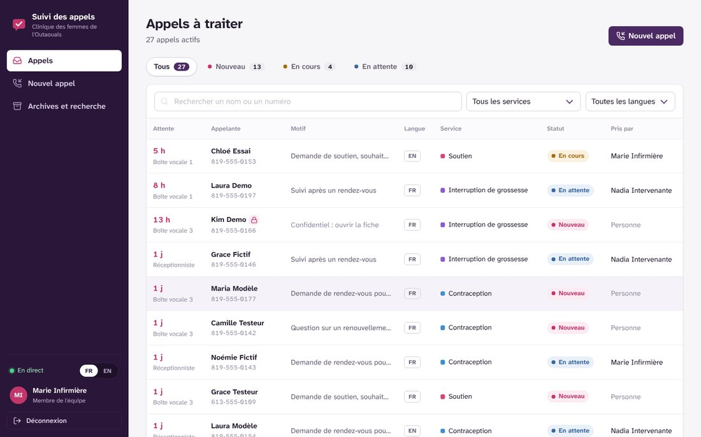
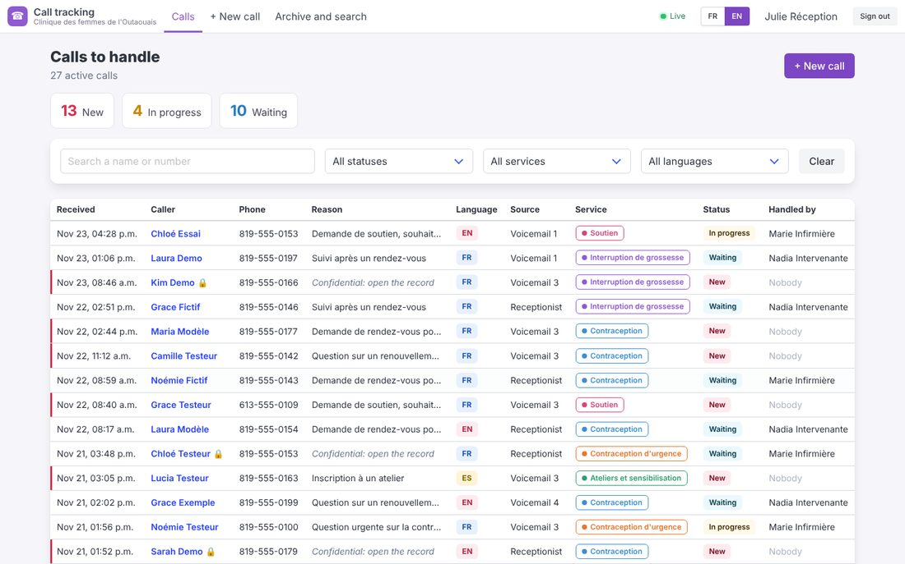
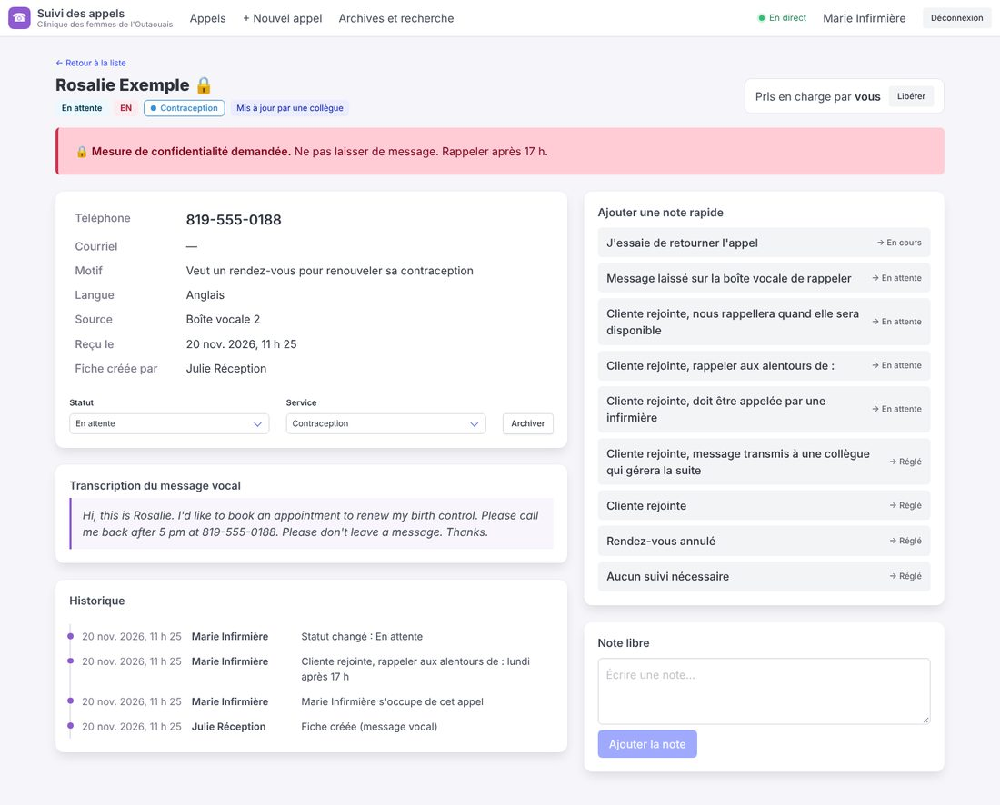
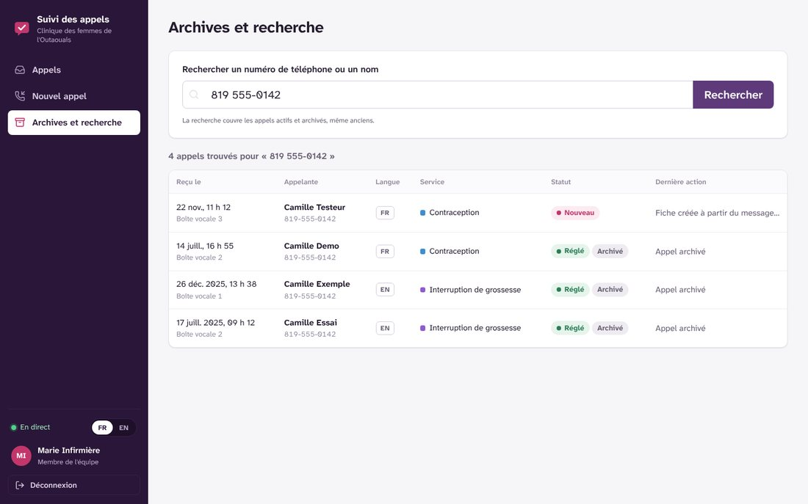

# Suivi des appels – Clinique des femmes de l'Outaouais

Prototype réalisé dans le cadre du cours **SED 2515 – Applications web et mobile** (Université d'Ottawa).

L'application regroupe en un seul endroit les messages des 4 boîtes vocales et les appels pris par la réceptionniste. Toute l'équipe voit **en direct** qui s'occupe de quel appel et ce qui a déjà été fait.

> ⚠️ **Toutes les données sont fictives.** N'entrez jamais de vraies informations de clientes dans ce prototype.



## Fonctionnalités

- Connexion par courriel et mot de passe (mots de passe chiffrés, session de 8 h, déconnexion après 30 min d'inactivité)
- Création d'une fiche d'appel : source (boîte vocale 1 à 4 ou réceptionniste), nom, téléphone, motif, langue (FR/EN/ES), date et heure, transcription du message vocal
- Mesure de confidentialité : cadenas 🔒 dans la liste, motif masqué, consigne bien visible sur la fiche
- **Temps réel** (Socket.io) : les nouveaux appels et les changements apparaissent chez tout le monde sans rafraîchir
- Bouton **« Je m'en occupe »** pour éviter que deux personnes rappellent la même cliente
- **Notes rapides** en un clic (à compléter au besoin) + notes libres ; chaque note change le statut si nécessaire
- Historique complet : qui a fait quoi, et quand
- Statuts : Nouveau, En cours, En attente, Réglé ; un appel réglé part aux archives
- Filtres par statut, service (avec couleurs) et langue
- **Recherche par numéro de téléphone** dans tous les appels, même anciens
- Administration : modifier les notes rapides, les services et leurs couleurs, les comptes de l'équipe
- **Interface bilingue** : bouton **FR / EN** dans la barre du haut (et sur la page de connexion), mémorisé sur chaque ordinateur. Les notes rapides et les noms des services restent dans la langue où l'administratrice les a écrits.



| Fiche d'un appel | Recherche par numéro |
| --- | --- |
|  |  |

## Technologies

| Partie | Outils |
| --- | --- |
| Front-end | React 19 (Vite), React Router, Bulma CSS, socket.io-client |
| Back-end | Node.js, Express, Socket.io, jsonwebtoken, bcryptjs |
| Base de données | MySQL (mysql2) – fonctionne avec XAMPP |

## Installation (à faire une seule fois)

**Prérequis :** [Node.js](https://nodejs.org) 20 ou plus, et MySQL démarré (dans XAMPP : bouton *Start* à côté de MySQL).

```bash
# 1. Installer les dépendances (racine, serveur et client)
npm run setup

# 2. Créer le fichier de configuration du serveur
#    Windows :     copy server\.env.example server\.env
#    Mac / Linux : cp server/.env.example server/.env
#    Puis ouvrez server/.env et changez JWT_SECRET (et DB_PASSWORD si besoin)

# 3. Créer la base de données avec les données fictives
npm run db:init
```

## Lancer l'application

```bash
npm run dev
```

Ouvrez **http://localhost:5173**. Le serveur tourne sur le port 4000 ; Vite lui transmet les requêtes `/api` et `/socket.io`.

### Comptes de démonstration

Mot de passe pour tous : **`Demo123!`**

| Courriel | Rôle |
| --- | --- |
| `admin@clinique.test` | Administratrice |
| `reception@clinique.test` | Réceptionniste |
| `infirmiere@clinique.test` | Infirmière |
| `intervenante@clinique.test` | Intervenante |

### Voir le temps réel

1. Connectez-vous avec `reception@clinique.test` dans une fenêtre normale.
2. Connectez-vous avec `infirmiere@clinique.test` dans une **fenêtre de navigation privée**.
3. Créez un appel d'un côté : il apparaît tout de suite de l'autre.

Pour remettre les données à zéro : `npm run db:init`.

## Structure du projet

```
clinique-appels/
├── client/                    Front-end React
│   └── src/
│       ├── pages/             Connexion, Tableau, NouvelAppel, Fiche, Archives, Admin
│       ├── components/        Navigation, étiquettes (statut, service, langue)
│       ├── AuthContext.jsx    Connexion + Socket.io partagés dans l'app
│       ├── i18n.jsx           Textes français et anglais + bouton FR/EN
│       ├── api.js             Appels à l'API avec le jeton
│       └── styles.css
├── server/                    Back-end Express
│   ├── db/schema.sql          Les 5 tables
│   ├── db/seed.js             Crée la base et les données fictives
│   └── src/
│       ├── index.js           Démarrage du serveur
│       ├── auth.js            Login, jetons JWT, droits
│       ├── temps-reel.js      Socket.io
│       └── routes/            appels.js, configuration.js
└── docs/captures/             Captures d'écran
```

## API

Toutes les routes, sauf la connexion, demandent l'en-tête `Authorization: Bearer <jeton>`.

| Méthode | Route | Rôle |
| --- | --- | --- |
| POST | `/api/auth/login` | Connexion, renvoie un jeton |
| GET | `/api/appels?statut=&service=&langue=&archive=0\|1\|tous&q=` | Liste filtrée ; `q` = numéro ou nom |
| POST | `/api/appels` | Créer une fiche |
| GET | `/api/appels/:id` | Fiche + historique |
| PATCH | `/api/appels/:id` | Statut, service, prise en charge (`"moi"` ou `null`), archive, informations |
| POST | `/api/appels/:id/actions` | Note rapide (`note_rapide_id` + `texte` facultatif) ou note libre (`texte`) |
| GET / POST / PATCH | `/api/notes-rapides` | Notes rapides (modification : admin) |
| GET / POST / PATCH | `/api/services` | Services (modification : admin) |
| GET / POST / PATCH | `/api/utilisateurs` | Comptes (admin seulement) |

Événements Socket.io envoyés par le serveur : `appel:cree`, `appel:modifie`, `configuration:modifiee`.

## Sécurité

- Mots de passe hachés avec bcrypt, jamais stockés en clair
- Jetons JWT signés, valides 8 h ; Socket.io refuse les connexions sans jeton
- Requêtes SQL paramétrées (protection contre l'injection SQL)
- Secrets dans `server/.env`, exclu de Git
- Rôles : seules les administratrices modifient la configuration et les comptes

Pour une vraie mise en service, la clinique devra choisir l'hébergement des données avec sa personne responsable des renseignements personnels.

## Mettre le projet sur GitHub

```bash
git init
git add .
git commit -m "Premier prototype du suivi des appels"
git branch -M main
git remote add origin https://github.com/VOTRE-COMPTE/clinique-appels.git
git push -u origin main
```

Vérifiez avant le premier `git push` que `server/.env` n'apparaît **pas** dans `git status`.

## Utilisation de l'IA générative

Comme l'exige le cours, l'utilisation de l'IA est documentée dans [IA.md](IA.md).
